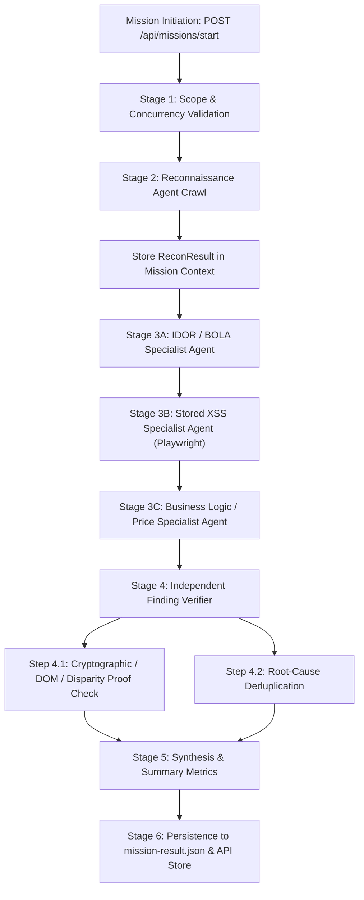

# BUGBOUNTY SWARM — Mission Orchestrator Report

> **Mission Orchestration Status:** `completed` (All tests passing, Exit Code: 0)  
> **Target Scope:** `http://localhost:4000/shop` (Restricted to local intentionally vulnerable demo shop)  
> **Architecture Module:** `apps/server/src/orchestrator/`  

---

## 1. Executive Summary

The **BUGBOUNTY SWARM Mission Orchestrator** unifies autonomous reconnaissance, specialist agent execution, and independent finding verification into a single coordinator.

The orchestrator enforces strict sequential execution across all specialist agents, preserving the shared in-memory database test isolation. Discovered pages, endpoints, and forms from the **Reconnaissance Agent** are dynamically distributed to the **IDOR/BOLA Agent**, **Stored XSS Agent**, and **Business Logic Agent**.

An independent **Finding Verifier** inspects every raw finding against verifiable proof criteria (differential access control tokens, real browser DOM execution sentinels, and authoritative price discrepancies), deduplicating findings sharing the same root cause without discarding supporting evidence.

All mission reports are persisted with zero leaked credentials, and REST API endpoints (`POST /api/missions/start`, `GET /api/missions`, `GET /api/missions/:missionId`) are integrated into the server.

---

## 2. Architecture & Execution Flow

### Files Created & Modified

| File | Status | Purpose |
|---|---|---|
| `apps/server/src/orchestrator/types.ts` | **Created** | Data contracts for orchestrator, execution records, verified findings, rejected findings, summaries. |
| `apps/server/src/orchestrator/finding-verifier.ts` | **Created** | Independent verification logic validating differential access control, 4-way XSS DOM proof, and price integrity. |
| `apps/server/src/orchestrator/mission-orchestrator.ts` | **Created** | Sequential coordinator, concurrency lock manager, persistence writer, credential sanitizer. |
| `apps/server/src/orchestrator/index.ts` | **Created** | Module exports and `runSecurityMission` public entrypoint. |
| `apps/server/src/index.ts` | **Modified** | Integrated `/api/missions/start`, `/api/missions`, `/api/missions/:missionId`. |
| `apps/server/tests/mission-orchestrator.test.ts` | **Created** | Comprehensive 12-stage end-to-end orchestrator test suite. |
| `apps/server/package.json` | **Modified** | Added `"test:mission"` script. |

---

## 3. Agent Execution Statuses & Metrics

From live mission execution (`test-mission-1794597681131`):

| Agent | Status | Duration | Raw Findings | Notes |
|---|---|---|---|---|
| **Reconnaissance Agent** | `completed` | 52,124 ms | 0 | Discovered 8 pages, 13 endpoints, 7 forms |
| **IDOR / BOLA Agent** | `completed` | 48 ms | 1 | Evaluated `/shop/api/orders/:id` via cross-user differential probes |
| **Stored XSS Agent** | `completed` | 26,761 ms | 1 | Evaluated 4 product review inputs via Playwright Chromium browser DOM |
| **Business Logic Agent** | `completed` | 18 ms | 1 | Evaluated `/shop/api/checkout` against authoritative catalog pricing |
| **Total Duration** | — | **78,955 ms** | **3** | All 4 agents executed cleanly without errors |

---

## 4. Independent Verification & Unique Vulnerabilities

The **Finding Verifier** confirmed **3 distinct root-cause vulnerabilities** across **6 tested input instances**:

### Finding 1: Broken Object Level Authorization (IDOR / BOLA)
- **ID:** `VF-001` (Original: `idor-find-001`)
- **Severity:** `High`
- **Affected Endpoint:** `GET /shop/api/orders/:id`
- **Verification Proof:** Alice (`user-alice`) accessed Bob's private order (`order-bob-001`) with HTTP 200, exposing sensitive fields (`items`, `total`, `createdAt`, `userId`).
- **Remediation:** Enforce server-side ownership checks (`order.userId === req.userId`) before returning order details.

### Finding 2: Stored Cross-Site Scripting (Stored XSS)
- **ID:** `VF-002` (Original: `xss-find-001`)
- **Severity:** `High`
- **Affected Endpoint:** `POST /shop/api/products/:id/reviews`
- **Affected Pages:** `/shop/products/prod-001`, `/shop/products/prod-002`, `/shop/products/prod-003`, `/shop/products/prod-004` (4 tested inputs)
- **Verification Proof:** 4-way criteria satisfied: review payload persisted verbatim in database, rendered via dangerous `element.innerHTML` sink, and executed sentinel handler (`window.__bb_xss_...`) in Chromium DOM context.
- **Deduplication:** Consolidated 4 product page inputs into 1 root-cause finding, preserving all 4 browser DOM execution proofs in `allEvidence`.
- **Remediation:** Assign review content via `element.textContent` or sanitize using DOMPurify before DOM insertion.

### Finding 3: Client-Side Price Manipulation
- **ID:** `VF-003` (Original: `bizlogic-find-001`)
- **Severity:** `High`
- **Affected Endpoint:** `POST /shop/api/checkout`
- **Verification Proof:** Server accepted client-supplied price of `1 cent` ($0.01) instead of authoritative catalog price `7,999 cents` ($79.99), creating order `order-alice-100` with an undercharge of `7,998 cents` ($79.98).
- **Remediation:** Never trust client-supplied prices. Look up canonical product prices server-side from the database using `productId`.

---

## 5. REST API Endpoints

The backend server exposes the following endpoints for mission management:

| Method | Endpoint | Description | Status Codes |
|---|---|---|---|
| `POST` | `/api/missions/start` | Initiates an autonomous mission against the local demo shop. | `200 OK` (completed), `400 Bad Request` (out of scope), `409 Conflict` (busy) |
| `GET` | `/api/missions` | Lists summaries of all completed missions. | `200 OK` |
| `GET` | `/api/missions/:missionId` | Retrieves full mission report with execution records and verified findings. | `200 OK`, `404 Not Found` |

---

## 6. Verification Test Suite Results

All test suites were executed and verified against the live application:

| Test Script | Command | Exit Code | Result |
|---|---|---|---|
| **TypeScript Check** | `node node_modules/typescript/bin/tsc --noEmit` | **0** | Clean, 0 errors |
| **Recon Agent** | `node node_modules/tsx/dist/cli.mjs tests/recon-agent.test.ts` | **0** | Discovered 8 pages, 13 endpoints, 7 forms |
| **IDOR Agent** | `node node_modules/tsx/dist/cli.mjs tests/idor-agent.test.ts` | **0** | IDOR verified on `/shop/api/orders/:id` |
| **XSS Agent** | `node node_modules/tsx/dist/cli.mjs tests/xss-agent.test.ts` | **0** | 4-way Playwright DOM proof confirmed |
| **Business Logic Agent** | `node node_modules/tsx/dist/cli.mjs tests/business-logic-agent.test.ts` | **0** | Price disparity confirmed on `/shop/api/checkout` |
| **Full Security Suite** | `node node_modules/tsx/dist/cli.mjs tests/run-all.ts` | **0** | All 3 vulnerabilities confirmed (`IDOR-001`, `XSS-001`, `PRICE-001`) |
| **Mission Orchestrator** | `node node_modules/tsx/dist/cli.mjs tests/mission-orchestrator.test.ts` | **0** | All 12 end-to-end checks passed |
| **Frontend Production Build** | `cd apps/web && node node_modules/vite/bin/vite.js build` | **0** | Built cleanly in 999ms |

---

## 7. Known Limitations

- **Concurrency Scope:** Missions are strictly locked to single-threaded sequential execution. Because the local demo shop uses an in-memory state that is reset between agent tasks, concurrent missions will return HTTP 409 Conflict.
- **Target Restriction:** Targets outside `http://localhost:4000/shop` are strictly rejected by both the API and the orchestrator core.
- **Blockchain / NEAR:** Decentralized verification, on-chain bounty claiming, and smart contracts are slated for the subsequent hackathon milestone.
